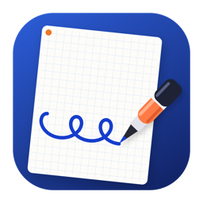
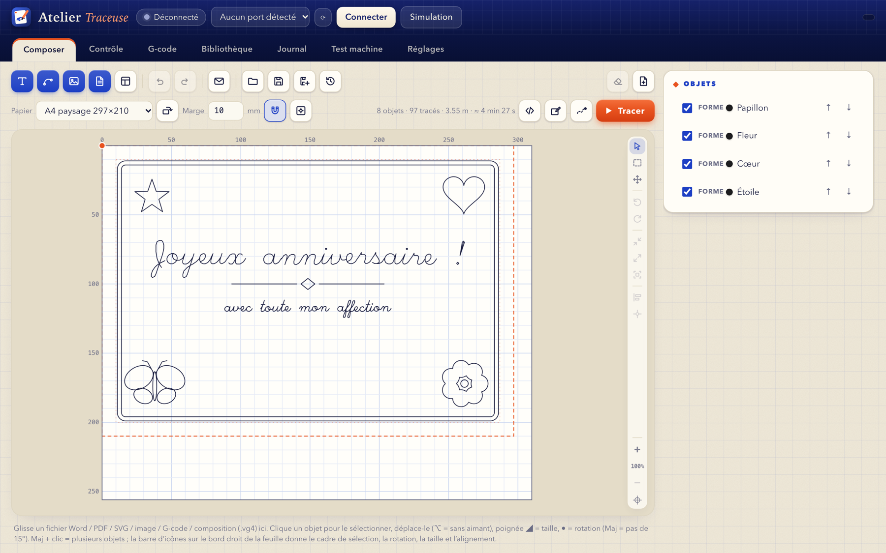
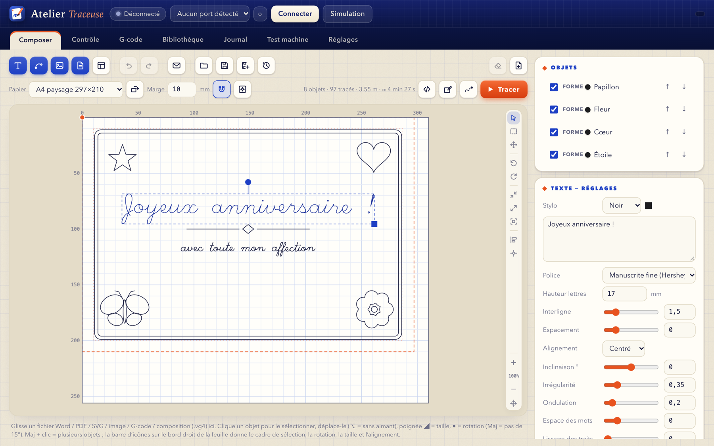
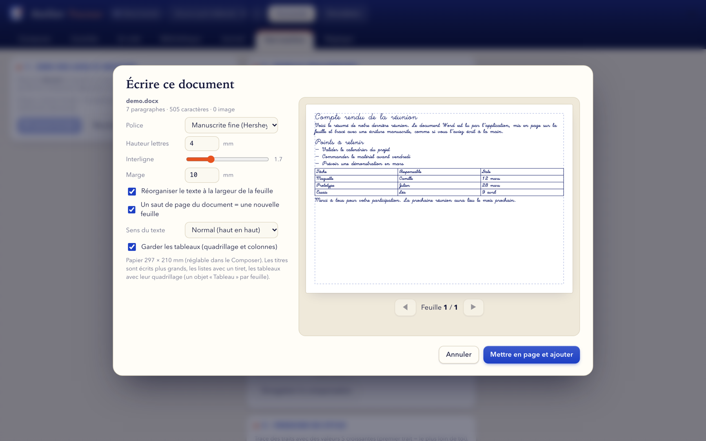
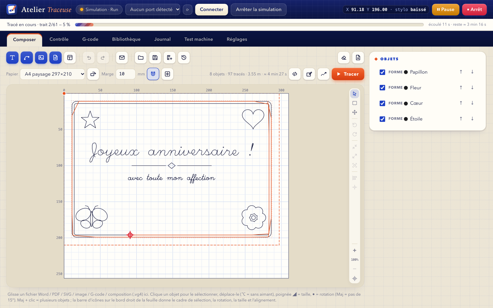
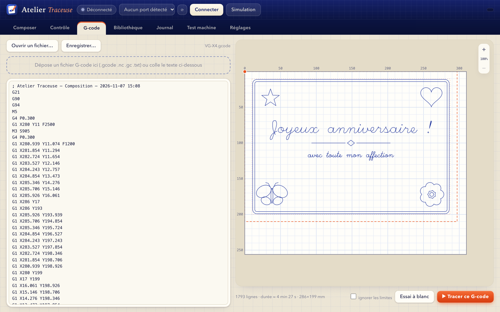
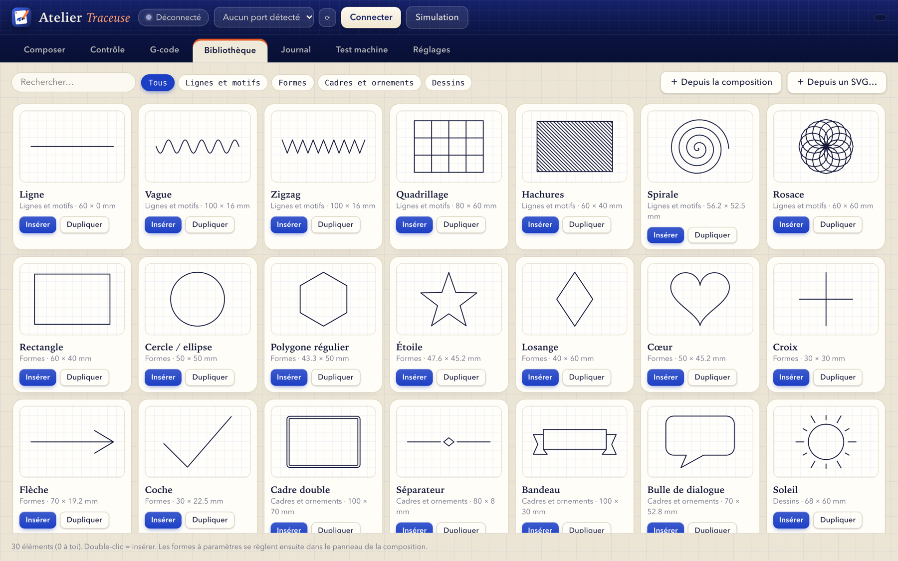
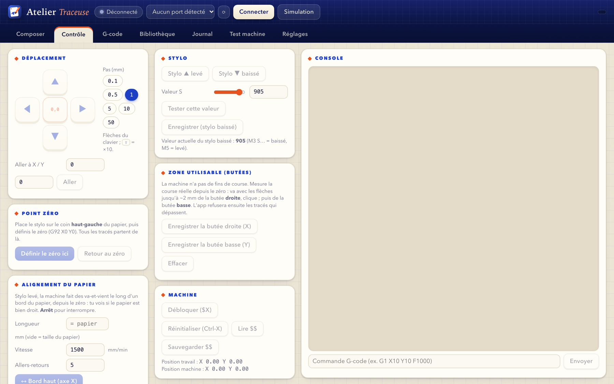

<div align="center">



# Atelier Traceuse

**A Mac app to drive the VigoTec VG-X4 pen plotter (GRBL):**
handwriting, drawings, Word and PDF documents, live plotting.

[](LICENSE)


[**⬇ Download**](https://github.com/Wudstyz/VG-X4/releases/latest) · [Français](README.md) · [Detailed features (French)](docs/FONCTIONNALITES.md)



</div>

---

Atelier Traceuse turns text, drawings or documents into pen paths that your plotter draws on real paper.
The app is **self-contained** (Python and all libraries are inside): drag it to *Applications* and open it, nothing else to install.

> **Independent project**, not affiliated with VigoTec. Tested on one real VG-X4 (GRBL 1.1f firmware). Other GRBL pen plotters may work but have not been tried.
> See [Compatibility](#compatibility). **The interface is in French** for now.

## What it does

| | |
|---|---|
| ✍️ **Handwriting** | Text drawn with single-stroke fonts (Hershey: cursive, script, gothic, marker…) or with macOS fonts. Slant, irregularity, baseline wobble and spacing make a page look hand-written. |
| 📄 **Word and PDF** | Drop a `.docx` or `.pdf`: text, headings, lists, images and **tables** are laid out on sheets and plotted. Live handwritten preview, sheet by sheet. |
| 🎨 **Drawings and SVG** | 30 parametric shapes and drawings (frames, stars, flowers, butterflies…), multicolour SVG import (one pen per colour), hatch fill for filled shapes. |
| 🖼️ **Images** | Outlines, detected lines (best for drawings and illustrations), hatching or grey levels (cross-hatching) from a PNG or JPEG. |
| ✉️ **Templates and mail merge** | Envelope, card, letter, label; one sheet per row of a CSV file with `{column}` placeholders in your texts. |
| 🧭 **Editor-style layout** | Selection, rotation, resizing, alignment, snapping to margins, zoom, undo/redo, several pens. |
| ⏱️ **Saves time** | Stroke order is optimised (about 40 % less pen-up travel on a page of text) and the duration is estimated from the GRBL planner model. |
| 🛡️ **Plotting safety** | Frame and dry run with the pen up, virtual limits, clean stop with resume at the exact stroke, auto-reconnect, simulation mode without a machine. |

## Screenshots

<table>
<tr>
<td width="50%"><br><sub><b>Composer</b>: text settings (font, slant, irregularity…).</sub></td>
<td width="50%"><br><sub><b>Word / PDF document</b>: handwritten layout, tables kept.</sub></td>
</tr>
<tr>
<td><br><sub><b>Live plotting</b>: path, pen position, progress, time left.</sub></td>
<td><br><sub><b>G-code</b>: preview and send a file or the composition.</sub></td>
</tr>
<tr>
<td><br><sub><b>Library</b>: parametric shapes and drawings, plus your own.</sub></td>
<td><br><sub><b>Control</b>: jog, pen, zero point, limits, GRBL console.</sub></td>
</tr>
</table>

## Installation

1. Download the `.dmg` from the [**Releases**](https://github.com/Wudstyz/VG-X4/releases/latest) page.
2. Open it and **drag *Atelier Traceuse* into *Applications***.
3. **First launch**: the app is not notarized by Apple (free project, no paid developer account), so macOS shows a warning.
   **Right-click the app → *Open* → *Open***. If macOS says the app is "damaged", open *System Settings → Privacy & Security* and click *Open Anyway*,
   or run once in Terminal: `xattr -dr com.apple.quarantine "/Applications/Atelier Traceuse.app"`.

**Requirements**: an **Apple Silicon** Mac (M1 or newer) running **macOS 14 (Sonoma) or later**. You don't need a machine to try the app: the *Simulation* button emulates the GRBL protocol.

## Getting started

1. **Plug in** the plotter over USB, open the app, pick the port and click **Connecter** (or **Simulation** to try without a machine).
2. In **Composer**, set the **paper** (size, orientation, margin), then add **text**, an **SVG**, an **image** or a **document** with the blue buttons.
3. Put the pen on the **top-left corner** of the paper, then go to **Contrôle → Définir le zéro ici** (set zero here).
4. Click **Cadre** (frame: the pen, raised, outlines the drawing) or **Essai à blanc** (dry run), then **▶ Tracer** (plot).

Useful settings: pen-down `S` value (default 905), speeds, axis inversion (Réglages), steps/mm calibration and backlash (Test machine).
A sample Word document is in [`examples/`](examples/demo.docx).

## Compatibility

- **Machine**: VigoTec VG-X4 with **GRBL 1.1** firmware (115200 baud, pen driven by `M3 S…` / `M5`). This is the only machine tested.
  Other GRBL plotters with a similar pen servo should work after adjusting the settings; no guarantee.
- **Computer**: macOS 14+ on Apple Silicon. No Windows, Linux or Intel build for now.
- **Known limits**: the machine has no limit switches and no position feedback (GRBL cannot tell whether a motor really moved); the app's limits are virtual, measured from zero.
  Word: no text boxes or footnotes, header and footer limited to text (no images); scanned PDFs: only the images are drawn.

## Build from source

You need an Apple Silicon Mac, `clang` (Xcode command line tools) and an Internet connection (to fetch a standalone Python and the libraries).

```bash
git clone https://github.com/Wudstyz/VG-X4.git
cd VG-X4
./build_app.sh      # builds "Atelier Traceuse.app" (embedded Python, SHA-256 verified)
./make_dmg.sh       # builds dist/Atelier-Traceuse-1.2-macOS-arm64.dmg
```

To develop without rebuilding the app:

```bash
python3 -m venv .venv && .venv/bin/pip install -r requirements.txt
.venv/bin/python app.py                 # native window
.venv/bin/python app.py --server 8765   # no window: open http://127.0.0.1:8765 in a browser
```

### Code layout

| File | Role |
|---|---|
| `app.py` | Native window (pywebview), local HTTP server and API |
| `index.html` | The whole UI (single file, no external dependency) |
| `grbl.py` | GRBL serial link, simulator, job execution, resume |
| `vec.py` | Text, SVG and images → paths; G-code generation and optimisation |
| `shapes.py` | Parametric shape library |
| `docimport.py` | Word and PDF reading and layout |
| `build_app.sh`, `make_dmg.sh`, `launcher.c`, `make_icon.py` | Build the app, the `.dmg` and the icon |

## Contributing

Feedback is welcome: open an issue for a bug, an idea, or to tell which machine you tried it on (model, GRBL firmware, result). Pull requests too.
A real plot can ruin a sheet, or even the machine: **always try a *Cadre* (frame) or *Essai à blanc* (dry run) first**.

## License and credits

[MIT](LICENSE) — see also [THIRD_PARTY_NOTICES.md](THIRD_PARTY_NOTICES.md). Hershey fonts: Dr. A. V. Hershey (NBS), through the MIT-licensed `Hershey-Fonts` package.
The machine protocol was checked against the MIT-licensed repository [Morgulisan/VGX4-Control](https://github.com/Morgulisan/VGX4-Control): no code was reused, only facts.
"VigoTec", "VG-X4" and "GRBL" belong to their respective owners; this project has no affiliation with them.

The software is provided as is, without warranty (see the license).
