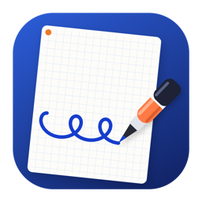
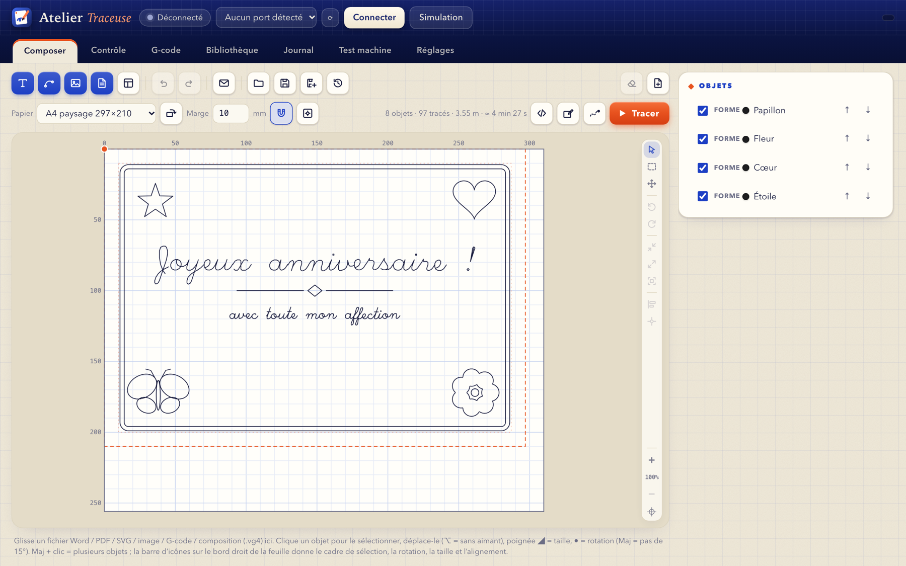
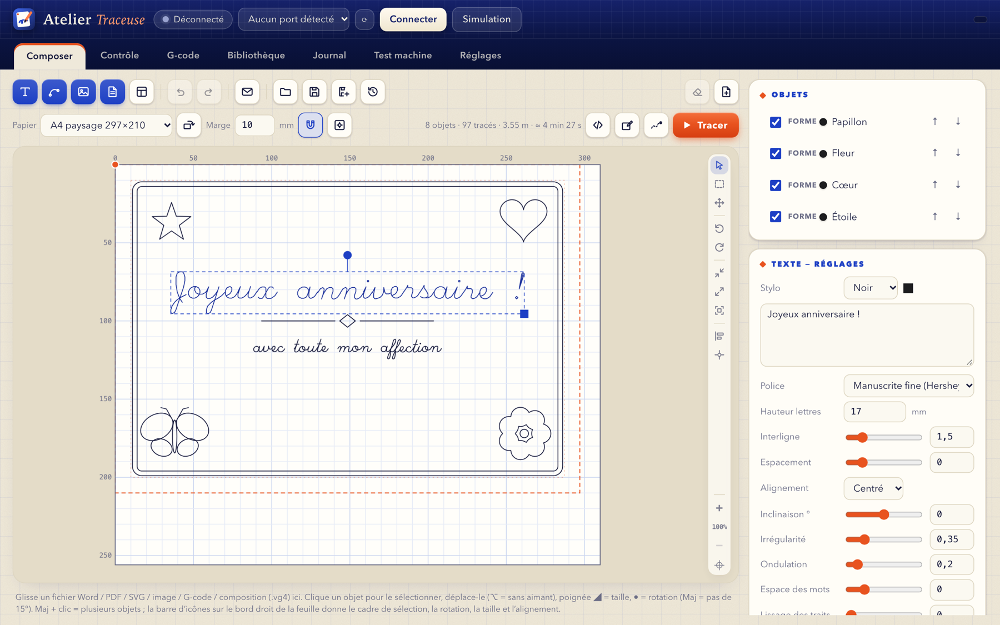
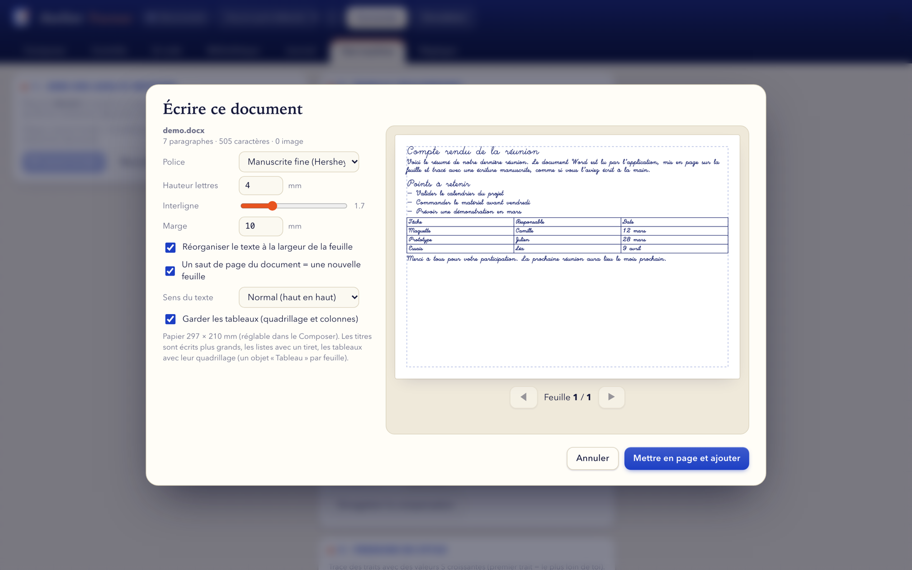
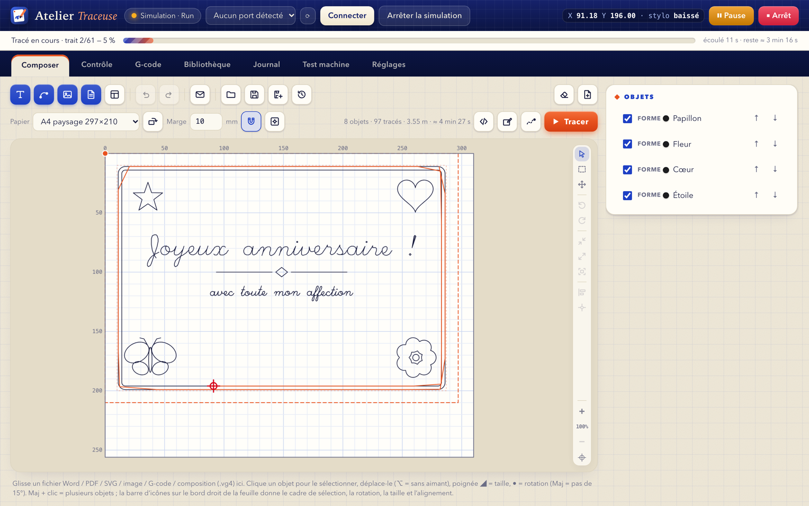
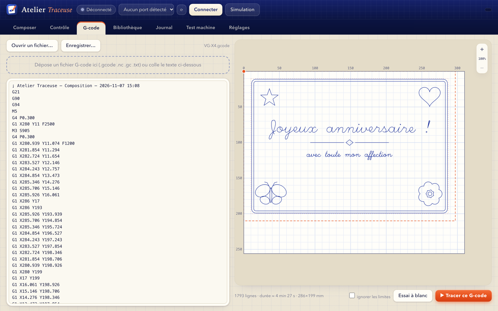
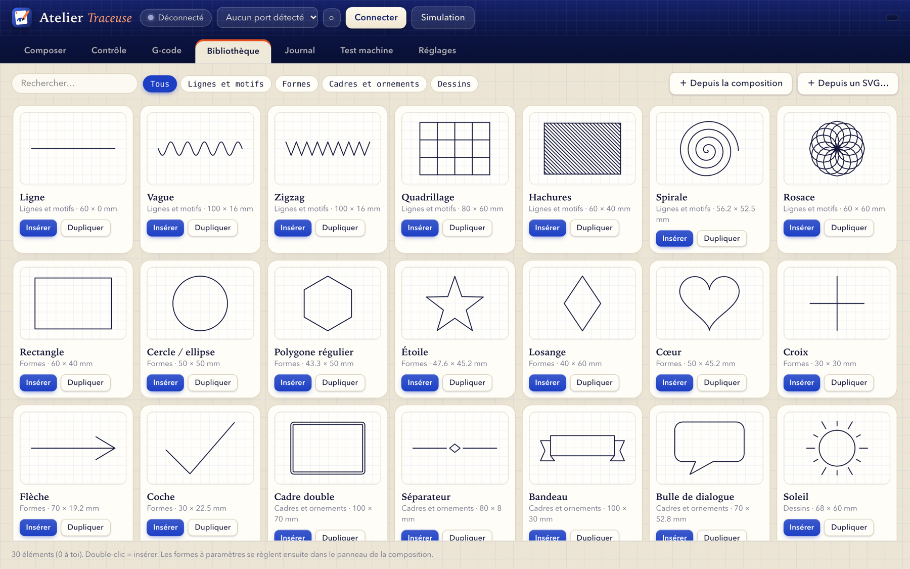
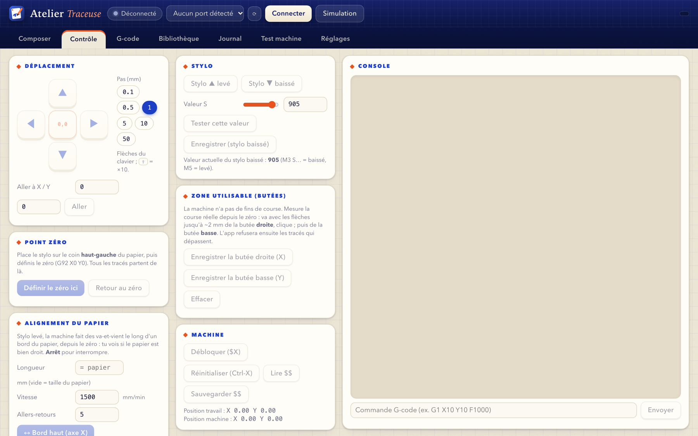

<div align="center">



# Atelier Traceuse

**Le logiciel Mac pour piloter la traceuse à stylo VigoTec VG-X4 (GRBL) :**
écriture manuscrite, dessins, documents Word et PDF, tracé en direct.

[](LICENSE)


[**⬇ Télécharger**](https://github.com/Wudstyz/VG-X4/releases/latest) · [English](README.en.md) · [Fonctionnalités détaillées](docs/FONCTIONNALITES.md)



</div>

---

Atelier Traceuse transforme un texte, un dessin ou un document en trajets que la traceuse dessine au stylo, sur une vraie feuille de papier.
L'app est **autonome** (Python et bibliothèques sont dedans) : on la glisse dans *Applications* et on l'ouvre, sans rien installer d'autre.

> **Projet indépendant** : non affilié à VigoTec. Testé sur une VG-X4 réelle (firmware GRBL 1.1f). Les autres traceuses GRBL à stylo
> peuvent fonctionner mais n'ont pas été essayées. Voir [Compatibilité](#compatibilité).

## Ce qu'elle fait

| | |
|---|---|
| ✍️ **Écriture manuscrite** | Texte tracé avec des polices à un trait (Hershey : cursive, script, gothique, feutre…) ou avec des polices du Mac. Inclinaison, irrégularité, ondulation de la ligne de base, espacement : la page ressemble à de l'écrit à la main. |
| 📄 **Word et PDF** | Glisser un `.docx` ou un `.pdf` : le texte, les titres, les listes, les images et les **tableaux** sont mis en page sur des feuilles et tracés. Aperçu manuscrit en direct, feuille par feuille. |
| 🎨 **Dessins et SVG** | 30 formes et dessins paramétrables (cadres, étoiles, fleurs, papillons…), import de SVG multicolores (un stylo par couleur), hachures pour remplir les formes. |
| 🖼️ **Images** | Contours, hachures ou tons de gris (hachures croisées) à partir d'un PNG ou d'un JPEG. |
| ✉️ **Modèles et publipostage** | Enveloppe, carte, lettre, étiquette ; une feuille par ligne d'un fichier CSV avec `{colonne}` dans les textes. |
| 🧭 **Composer comme dans un éditeur** | Sélection, rotation, taille, alignement, aimantation aux marges, zoom, annuler/rétablir, plusieurs stylos. |
| ⏱️ **Gain de temps** | L'ordre des tracés est optimisé (jusqu'à environ 40 % de déplacements à vide en moins sur du texte) et la durée est estimée d'après le modèle de la carte GRBL. |
| 🛡️ **Sécurité du tracé** | Cadre et essai à blanc stylo levé, butées virtuelles, arrêt propre avec reprise au trait près, reconnexion automatique, mode simulation sans machine. |

## Captures d'écran

<table>
<tr>
<td width="50%"><br><sub><b>Composer</b> : réglages d'un texte (police, inclinaison, irrégularité…).</sub></td>
<td width="50%"><br><sub><b>Document Word / PDF</b> : mise en page manuscrite, tableaux conservés.</sub></td>
</tr>
<tr>
<td><br><sub><b>Tracé en direct</b> : trajet, position du stylo, progression, temps restant.</sub></td>
<td><br><sub><b>G-code</b> : aperçu et envoi d'un fichier ou de la composition.</sub></td>
</tr>
<tr>
<td><br><sub><b>Bibliothèque</b> : formes et dessins paramétrables, les tiens en plus.</sub></td>
<td><br><sub><b>Contrôle</b> : déplacement, stylo, point zéro, butées, console GRBL.</sub></td>
</tr>
</table>

## Installation

1. Télécharger le fichier `.dmg` depuis la page [**Releases**](https://github.com/Wudstyz/VG-X4/releases/latest).
2. L'ouvrir et **glisser *Atelier Traceuse* dans *Applications***.
3. **Première ouverture** : l'app n'est pas notarisée par Apple (c'est un projet libre sans compte développeur payant), macOS affichera donc un avertissement.
   Faire un **clic droit sur l'app → *Ouvrir* → *Ouvrir***. Si macOS indique que l'app est « endommagée », ouvrir *Réglages Système → Confidentialité et sécurité* et cliquer sur *Ouvrir quand même*,
   ou lancer une fois dans le Terminal : `xattr -dr com.apple.quarantine "/Applications/Atelier Traceuse.app"`.

**Prérequis** : un Mac **Apple Silicon** (M1 ou plus récent) sous **macOS 14 (Sonoma) ou plus**. Une machine n'est pas nécessaire pour essayer l'app : le bouton *Simulation* reproduit le protocole GRBL.

## Premiers pas

1. **Brancher** la traceuse en USB, ouvrir l'app, choisir le port dans la liste et cliquer sur **Connecter** (ou **Simulation** pour essayer sans machine).
2. Dans **Composer**, régler le **papier** (format, orientation, marge), puis ajouter du **texte**, un **SVG**, une **image** ou un **document** avec les boutons bleus.
3. Placer le stylo sur le **coin haut-gauche** du papier, aller dans **Contrôle → Définir le zéro ici**.
4. Cliquer sur **Cadre** (le stylo levé fait le tour du dessin) ou **Essai à blanc**, puis sur **▶ Tracer**.

Réglages utiles : valeur `S` du stylo baissé (par défaut 905), vitesses, inversion des axes (Réglages), étalonnage des pas/mm et jeu mécanique (Test machine).
Tout est détaillé dans les [fonctionnalités](docs/FONCTIONNALITES.md). Un document Word d'exemple est dans [`examples/`](examples/demo.docx).

## Compatibilité

- **Machine** : VigoTec VG-X4 avec firmware **GRBL 1.1** (115200 bauds, stylo commandé par `M3 S…` / `M5`). C'est la seule machine testée.
  D'autres traceuses GRBL avec un servo de stylo similaire devraient marcher en ajustant les réglages ; sans garantie.
- **Ordinateur** : macOS 14+ sur Apple Silicon. Pas de version Windows, Linux ni Intel pour l'instant.
- **Limites connues** : la machine n'a ni fins de course ni retour de position (GRBL ne sait pas si un moteur a vraiment bougé) ; les butées de l'app sont des butées virtuelles mesurées depuis le zéro.
  Word : pas d'en-têtes/pieds de page, zones de texte, notes de bas de page ; PDF scannés : seules les images sont dessinées.

## Construire depuis les sources

Il faut un Mac Apple Silicon, `clang` (outils en ligne de commande Xcode) et une connexion Internet (pour télécharger un Python autonome et les bibliothèques).

```bash
git clone https://github.com/Wudstyz/VG-X4.git
cd VG-X4
./build_app.sh      # fabrique « Atelier Traceuse.app » (Python embarqué, vérifié par SHA-256)
./make_dmg.sh       # fabrique dist/Atelier-Traceuse-1.0-macOS-arm64.dmg
```

Pour développer sans reconstruire l'app :

```bash
python3 -m venv .venv && .venv/bin/pip install -r requirements.txt
.venv/bin/python app.py                 # fenêtre native
.venv/bin/python app.py --server 8765   # sans fenêtre : ouvrir http://127.0.0.1:8765 dans un navigateur
```

### Organisation du code

| Fichier | Rôle |
|---|---|
| `app.py` | Fenêtre native (pywebview), serveur HTTP local et API |
| `index.html` | Toute l'interface (un seul fichier, sans dépendance externe) |
| `grbl.py` | Liaison série GRBL, simulateur, exécution des tracés, reprise |
| `vec.py` | Texte, SVG et images → trajets ; génération et optimisation du G-code |
| `shapes.py` | Bibliothèque de formes paramétrables |
| `docimport.py` | Lecture et mise en page des documents Word et PDF |
| `build_app.sh`, `make_dmg.sh`, `launcher.c`, `make_icon.py` | Fabrication de l'app, du `.dmg` et de l'icône |

## Contribuer

Les retours sont les bienvenus : ouvrez une *issue* pour un bug, une idée, ou pour dire sur quelle machine vous l'avez essayée (modèle, firmware GRBL, résultat).
Les *pull requests* aussi. Un tracé réel peut abîmer une feuille voire la machine : **testez toujours avec un *Cadre* ou un *Essai à blanc* d'abord**.

## Licence et crédits

[MIT](LICENSE) — voir aussi [THIRD_PARTY_NOTICES.md](THIRD_PARTY_NOTICES.md). Polices Hershey : Dr A. V. Hershey (NBS), via le paquet MIT `Hershey-Fonts`.
Le protocole de la machine a été vérifié avec le dépôt MIT [Morgulisan/VGX4-Control](https://github.com/Morgulisan/VGX4-Control) : aucun code n'en a été réutilisé, seulement des faits.
« VigoTec », « VG-X4 » et « GRBL » appartiennent à leurs propriétaires ; ce projet n'a aucun lien avec eux.

Le logiciel est fourni tel quel, sans garantie (voir la licence).
